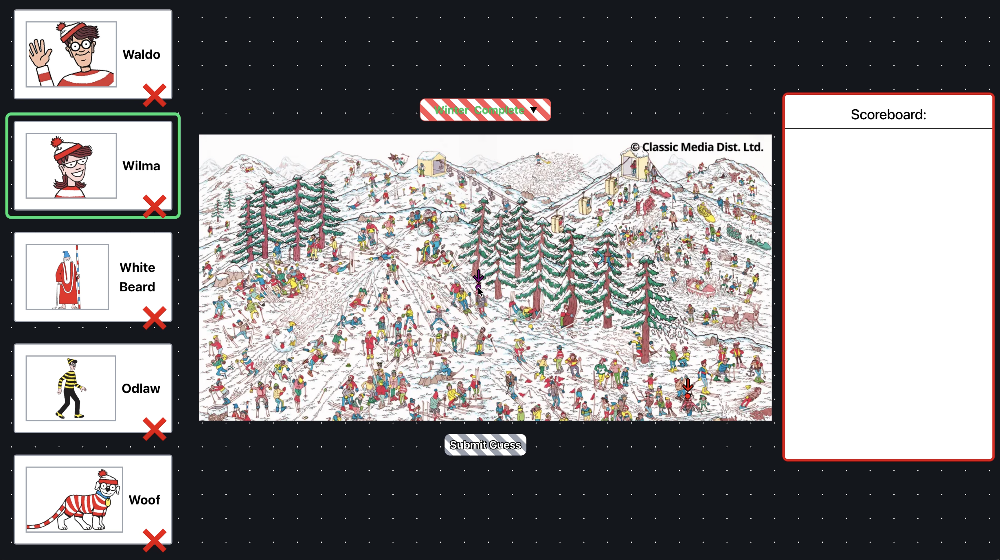

# Where-s-Waldo
A photo tagging app, inspired by "Where's Waldo"

## Expore 5 different maps and five all 5 characters in each!

## For the backend the following technlogies were used:
- NodeJS/Express - Backend
- Postgress - Database
- Prisma - ORM
- CORS
- Render - Backend/Database Deployment

## For the frontend the following technlogies were used:
- Vite - bundler
- React - Framework
- React-Router - Routing
- Tailwind - Styles
- HTTP - requests/api
- Vercel - Deployment

### [Click here](https://blog-api-frontend-eta.vercel.app/blogs) to try and find them all!

### Preview of the interfaces

##### None of the characters/maps are made bz be trademarks are held by creator Martin Handford, original publishers like Walker Books and Candlewick Press, and DreamWorks Distribution Limited (part of NBCUniversal)